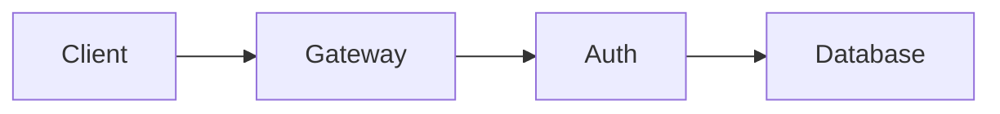

# Design Doc with an Embedded Diagram

Markdown often embeds Mermaid diagrams in a fenced ` ```mermaid ` block.
This file is **Markdown**, so `ahr` renders it with termimad — the diagram
below is shown as a fenced code block (its Mermaid source), not drawn.

## Request flow

The login request travels through the gateway before it reaches auth:



## Notes

- The prose, headings, and list render styled.
- To *draw* the diagram instead, feed the Mermaid block to `ahr` on its own
  (`ahr --format mermaid`), or pipe just the fenced block's contents.

> Rendering embedded ` ```mermaid ` blocks as drawn diagrams inline would be
> a future feature; today the two formats are rendered separately.
