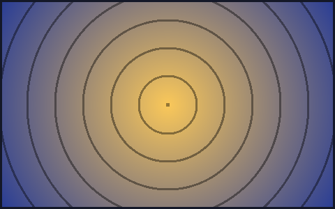

# H1 — Render Markdown in the Terminal

`ah-r` reads a Markdown file and prints a **styled** terminal view using
[termimad](https://crates.io/crates/termimad), themed with the Tokyo Night Moon
palette.

## H2 — Heading palette

### H3

#### H4

##### H5

###### H6

## Text formatting

This paragraph mixes **bold**, _italic_, **_bold italic_**, ~~strikethrough~~,
`inline code`, and a [link](https://example.com). Long paragraphs wrap to the
terminal width (or 80 columns when the output is piped) so nothing runs off the
edge.

An image renders as its alt text in the plain Markdown path:
.

## Lists

Unordered, with nesting:

- First item
- Second item
  - Nested item
  - Another nested item
- Third item

Ordered:

1. Clone the repo
2. Build the binary
3. Render a file

## Blockquote

> Markdown is a lightweight markup language.
> termimad gives it color and structure in the terminal.
>
> > Quotes can nest, too.

## Code block

```rust
fn main() {
    println!("hello, terminal markdown");
}
```

```
generic code block
```

## Horizontal rule

Above the rule.

---

Below the rule.

## Table

| Format   | Engine      | Output            |
| -------- | ----------- | ----------------- |
| mermaid  | figurehead  | box-drawing chars |
| markdown | termimad    | styled ANSI text  |
| table    | comfy-table | rounded grid      |
